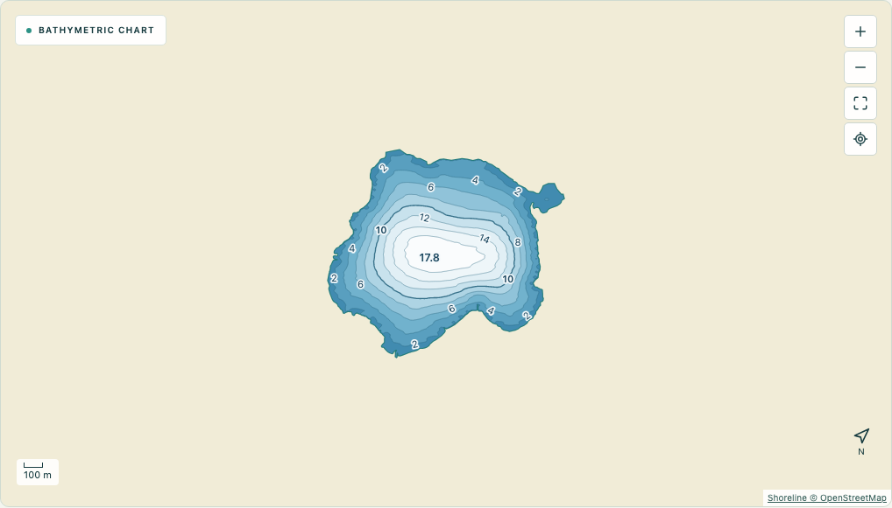

# DepthCalc

**Turn your own lake soundings into a depth map.**

[Try DepthCalc](https://patw1kkkk.github.io/depthcalc/) · [Capture](https://patw1kkkk.github.io/depthcalc/apps/capture/) · [Studio](https://patw1kkkk.github.io/depthcalc/apps/studio/)



**Try it in a minute:** open Studio → **Open Demo Lake** → **Bathymetric chart** → **Generate bathymetric map**. No account or equipment needed for the demo.

DepthCalc is an open-source toolkit for creating bathymetric lake maps from GPS + depth measurements. Use DepthCalc Capture to collect measurements on the lake and DepthCalc Studio to turn those measurements into coverage visualizations and bathymetric contour maps.

**Capture on the lake → Export session CSV → Import sessions into Studio → Analyze coverage → Generate a chart → Export PDF or PNG.**

Two static, client-side applications. No account, application server, cloud database, Google Sheets, Supabase, or GPT service. Your survey data stays in your browser unless you export a file. Built with TypeScript, React and Vite. All depth calculations run on your device.

## Run locally

Requires Node.js 22.13+ and npm.

```sh
git clone https://github.com/patw1kkkk/depthcalc.git
cd depthcalc
npm ci
npm run dev:capture
```

Capture opens at **http://localhost:5173/apps/capture/**.

In a second terminal, from the same directory:

```sh
npm run dev:studio
```

Studio opens at **http://localhost:5174/apps/studio/**. Each dev server serves both entry points; the two commands simply open the relevant app on separate ports. Browser storage is specific to the origin, including its port.

Phone GPS requires **HTTPS** (or localhost on the phone itself). Visiting your laptop's plain HTTP LAN address generally does not grant GPS access. For a phone, publish the static build on an HTTPS host or configure a trusted HTTPS development proxy. Keep Capture visible while measuring; mobile browsers do not guarantee background GPS. There is no native fish-finder connection: enter its displayed depth manually.

## Capture

1. Open Capture and allow GPS. The home screen shows the map and GPS accuracy. A fresh GPS fix is required to start.
2. Tap **Start session**, enter a name and confirm. The compact session view shows the name, GPS accuracy, elapsed time, measurement count and distance from your current GPS position to the previous measurement.
3. Enter the fish finder depth and tap **Add measurement** beside the field. The previous depth stays selected. GPS fixes older than 15 seconds cannot be used.
4. Switch between **Map** and **Measurements**. The table has 15 rows per page; edit or delete a point from either view.
5. Tap the red **End and export session CSV** button. The session is saved and a CSV download starts automatically. **Download session CSV** remains available for another copy, including after reload. Empty sessions are discarded.
6. Saved sessions can be selected for review or another download. Ended/reloaded sessions cannot resume; start a new named session for more measurements.

Writes are transactional in IndexedDB. A failed write displays an error and does not claim the point is saved. Capture requests a screen wake lock while recording when supported. No continuous travel track is recorded. Keep exported CSV backups before clearing browser storage.

## Studio

1. Create a new lake project. Pan/zoom the OpenStreetMap basemap or enter `latitude, longitude` to move to a lake.
2. Click water. An on-map spinner and shoreline-loading message appear immediately. Studio calls the public Overpass API directly, highlights the entire mapped lake, including island holes and separate water parts, and asks you to **Confirm lake & create project**. No drawing is required. Land clicks do not snap to a nearby lake.
3. Import one or more Capture CSVs together. Invalid files fail the whole batch with an explanation; existing data remains intact. Exact duplicate records (timestamp, coordinates, depth, accuracy) are skipped. Each file becomes a session unless its optional `session_id` column describes multiple sessions.
4. Inspect points and correct depths or delete errors. Click a session to highlight its points and filter the table. Remove an entire session when needed.
5. Open **Coverage** to find gaps. Adjust the GPS threshold; excluded/outside-lake points remain in the raw dataset.
6. Open **Bathymetric chart**, choose radius/contour interval, and generate the map. Changes invalidate the generated map; regenerate before export.
7. Export A4 landscape **PDF**, 2400 × 1650 **PNG**, combined **CSV**, or a complete **project file**.

Use **Open Demo Lake** to explore Käyrälampi, Finland, with synthetic boat-survey measurements and approximately 80% well-covered area, without a shoreline lookup. See [demo data and attribution](example-data/DEMO.md). For the full file workflow, import `example-data/empty-lake.depthcalc.json`, then import both example CSVs. These are synthetic test measurements, not a survey of the real location shown beneath them.

Projects are saved locally. **Export project** produces `lake-name.depthcalc.json`, including lake geometry, source, all sessions/measurements, and settings. **Import project** validates and restores it. If that lake ID already exists locally, an imported copy is created so the existing project is preserved. Generated grids are recomputed, not stored in the portable format.

## Algorithms and charts

Defaults live in [`packages/core/settings.ts`](packages/core/settings.ts):

| Setting                     | Default                                                 |
| --------------------------- | ------------------------------------------------------- |
| Coverage cells              | 13 × 13 m                                               |
| Covered distance            | ≤ 20 m from a usable measurement                        |
| Well covered                | ≥ 3 nearby measurements                                 |
| Maximum usable GPS accuracy | 35 m                                                    |
| IDW radius                  | 100 m; choices 20, 30, 40, 50, 100 m                    |
| IDW power/support           | Inverse distance squared; ≥ 3 distinct coordinates      |
| Contour interval            | 2 m; slider 1–6 m                                       |
| Smooth depth colors         | ON                                                      |
| Surface smoothing           | 30%; slider 0–100%, available when smooth colors are ON |

Coverage area and percentages are grid estimates. Large lakes automatically use a coarser grid to bound computation; the actual cell size is displayed. Points outside the water polygon, including islands, do not contribute. Duplicate coordinates cannot satisfy the three-location interpolation requirement. Where nearby data supports the shore extension, estimated depths taper toward an approximately 0 m shoreline. Unsupported water remains unknown.

The rendering pipeline uses a 2 m or adaptively coarser grid focused on the surveyed area, matching filled contour polygons and contour lines, bounded shoreline extension, scalar-field smoothing, batched pixel rendering and cursor depth readout. Smoothing runs before contour generation, preserves the known field’s mean and leaves raw measurements unchanged. At 0% the original generated field is retained exactly. OFF uses the original pixel colors and hides the smoothing control while preserving its selected value. PDF and PNG use the same generated surface and settings as the map.

Land is light neutral yellow; shallower bands are blue and deeper bands approach white. Unknown water remains grey/hatched. PDF and PNG include shoreline, scale, north arrow and legend. Exports cover the whole lake; cropped exports are not included in this edition.

## Files and architecture

```text
apps/
  capture/                 Mobile capture entry point
  studio/                  Desktop studio entry point
packages/
  core/
    geometry.ts            Polygon/MultiPolygon and island handling
    survey.ts              Measurement types, projection, coverage and IDW
    settings.ts            Shared maintainable defaults
    surface.ts             Matched discrete bands and contour segments
    cartography.ts         Palette, joined contours, labels and spot depths
    lake-selection.ts      Original OSM conversion and exact containment
    lake-provider.ts       Direct browser Overpass lookup
    files.ts               CSV and versioned project validation/export
    storage.ts             IndexedDB persistence
    export-pdf.ts          Adapted vector PDF exporter
    export-image.ts        Standalone chart SVG and PNG export
  ui/                      Shared map, editor, persistence hook and styles
example-data/              Two CSV sessions and portable example projects
tests/                     Algorithm/file tests and browser workflow tests
docs/                      Formats, implementation provenance and verification
```

See [CSV/project formats](docs/FORMATS.md), [reuse notes](docs/IMPLEMENTATION.md), and [testing](docs/TESTING.md).

## Build, test and static hosting

```sh
npm test
npm run build
npx playwright install chromium
npm run test:e2e
npm run preview
```

The build emits **only static files** in `dist/`. Serve the entire directory on any HTTPS static host (including GitHub Pages). Open `/apps/capture/` or `/apps/studio/` under the deployed base path. Asset URLs are relative, so a GitHub Pages repository subpath is supported. A root landing page links to both apps. No environment variables or API keys are needed. Do not open the HTML using `file://`.

For optional live public-service verification:

```sh
DEPTHCALC_LIVE_OSM=1 npm run test:e2e
```

## Practical limits

- The application shell must load first. There is no service worker or guarantee of reopening/reloading offline. Once Studio is loaded, analysis and CSV/project/PDF/PNG exports work without network; Capture can record with GPS without internet while open.
- Basemap tiles and new shoreline lookups require internet and public OSM services. They can be slow, rate limited, incomplete, or unavailable. Imported project geometry works without lookup. No survey points are uploaded; tile/lookup requests reveal the map region or clicked location to those public providers.
- Keep backups: clearing browser data, private browsing, or browser storage eviction can remove local projects. Use one editing tab per app/origin to avoid competing local edits.
- Supported latitude range is ±85°. Limits: 100,000 measurements per Studio project, 20 MB per CSV, 40 MB per project JSON; shoreline limits are 12 MiB response, 100,000 coordinates, and 1.5 million serialized geometry characters. Large datasets may pause the UI during computation; adaptive grids bound surface size.
- Charts estimate bathymetry from your measurements. They are **not navigation charts**. Real phone GPS and fish-finder accuracy require field validation.

## License and attribution

MIT; see [LICENSE](LICENSE). Adapted from the existing DepthCalc implementation in this workspace; see [NOTICE](NOTICE). OSM geometry and tiles remain subject to their own attribution/license terms. The apps and charts retain OpenStreetMap attribution where OSM shoreline data is used. Dependencies retain their respective licenses.

## Feedback and contributions

Found a bug or have a mapping idea? [Open an issue](https://github.com/patw1kkkk/depthcalc/issues). Include your browser, steps to reproduce, and a synthetic example if possible. Please avoid sharing private survey locations. Contributions are welcome; run the tests and production build before opening a pull request. If DepthCalc is useful to you, a GitHub star helps others discover it.
